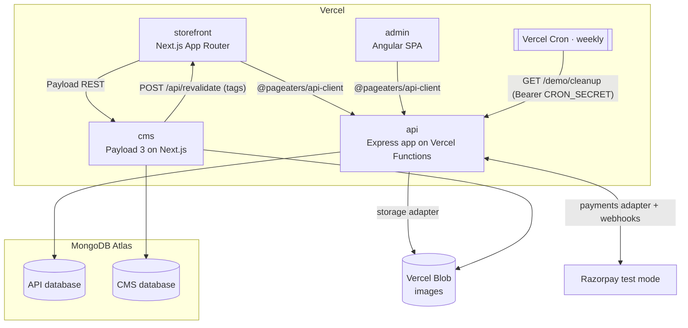
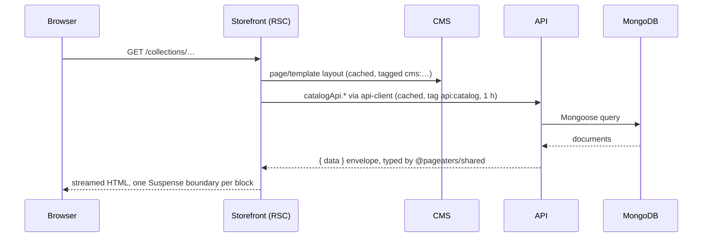

# Architecture

Pageaters has four apps and four shared packages in one Turborepo, deployed as a sandboxed portfolio demo.
The main rule is a **content/commerce boundary**. The API owns commerce data: books, prices, stock, carts, orders
and users. Payload owns content: pages, blocks, navigation and SEO. The CMS refers to commerce records only by ID.
For the reasons behind this, see [ADR 0004](./adr/0004-payload-cms-content-commerce-boundary.md).

## System

## Request flow: a catalog page

- **Anonymous catalog reads** go through `catalogApi` (`apps/storefront/src/lib/api.ts`). These requests are
  cached and tagged `api:catalog`, and the cache expires every hour. The catalog is read-only in the demo, so an
  hour of staleness does no harm.
- **Shopper calls** for cart, checkout and orders use a separate client that sends the visitor's cookies.
- **CMS reads** go through `cmsFetch` (`apps/storefront/src/lib/cms.ts`). Each read is tagged, and a 5-minute
  expiry acts as a safety net. If the CMS is down, the read returns `null`, so the page falls back to its defaults.
- **Revalidation:** when an editor publishes, unpublishes or deletes content, Payload hooks
  (`apps/cms/src/hooks/revalidate.ts`) send `POST` to the storefront's `/api/revalidate` with the affected tags
  and the `x-revalidate-secret` header. The route (`apps/storefront/src/app/api/revalidate/route.ts`) then
  expires those tags right away. Saving a draft does nothing.

## Contracts

`packages/shared` defines the domain enums and the request and response schemas in zod, once. Three places use them:

- **API:** the `validate()` middleware checks request bodies, and the OpenAPI spec at `/docs` is built from the
  same schemas. The API is JavaScript and loads the built `dist/` of the package
  ([ADR 0001](./adr/0001-api-stays-javascript.md)).
- **api-client:** it gives typed endpoints for the storefront and admin, and can check responses against the schemas.
- **Forms:** frontend forms validate with the same schemas.

`packages/cms-types` is generated from the Payload config with `pnpm cms:types`. It keeps the CMS blocks and the
storefront components in sync.

## Adapters

Every third-party service sits behind an adapter in `apps/api/src/adapters/<kind>`. Each adapter has a real
implementation and a `mock`, and the mock is the default
([ADR 0006](./adr/0006-serverless-api-and-adapters.md)).

| Kind     | Real        | Demo                                    |
| -------- | ----------- | --------------------------------------- |
| payments | Razorpay    | Razorpay with `rzp_test_…` keys only    |
| email    | SendGrid    | mock, which writes to the in-app outbox |
| sms      | Twilio      | mock                                    |
| shipping | Delhivery   | mock                                    |
| storage  | Vercel Blob | Blob (only the super-admin can upload)  |

`src/env.js` refuses to start the API if it finds a `rzp_live_` key. For the full adapter rules, see
`apps/api/src/adapters/README.md`.

## Serverless rules

The API keeps no state in the process. It runs no timers and writes nothing to local disk. At boot it does
nothing except connect to the database. `src/app.js` exports the Express app for Vercel Functions, and
`src/server.js` is only for running it locally. Scheduled work is done by Vercel Cron, which calls protected
endpoints. Today that means the weekly demo cleanup.

## Hosting

| Piece      | Where                                          |
| ---------- | ---------------------------------------------- |
| storefront | Vercel, `demo.pageaters.com`                   |
| admin      | Vercel, `admin.demo.pageaters.com`             |
| cms        | Vercel, `cms.demo.pageaters.com`               |
| api        | Vercel Functions, `api.demo.pageaters.com`     |
| data       | MongoDB Atlas (separate API and CMS databases) |
| files      | Vercel Blob                                    |

These hosts go live with the Phase 10 deployment. For details, see [deployment.md](./deployment.md).

## Related

- [business-flows.md](./business-flows.md), [order-lifecycle.md](./order-lifecycle.md), [demo-mode.md](./demo-mode.md)
- ADRs: [0003 monorepo](./adr/0003-turborepo-monorepo.md),
  [0005 App Router + Tailwind/shadcn](./adr/0005-next-app-router-tailwind-shadcn.md),
  [0007 demo sandbox](./adr/0007-demo-mode-sandbox.md),
  [0009 Angular admin upgraded](./adr/0009-angular-admin-upgraded-not-rewritten.md)
