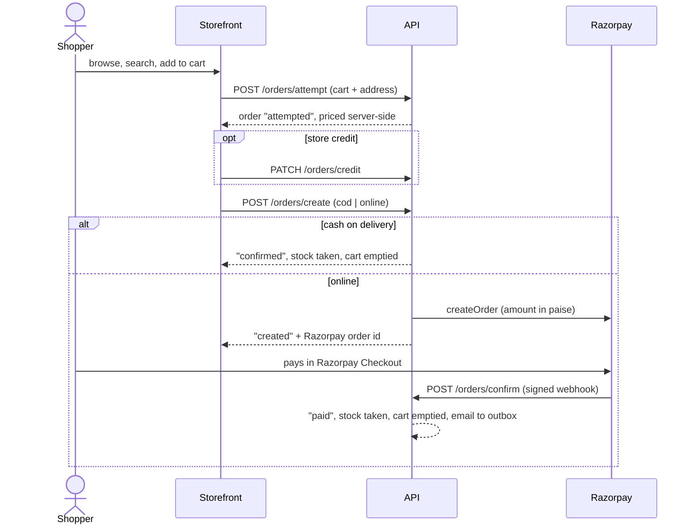
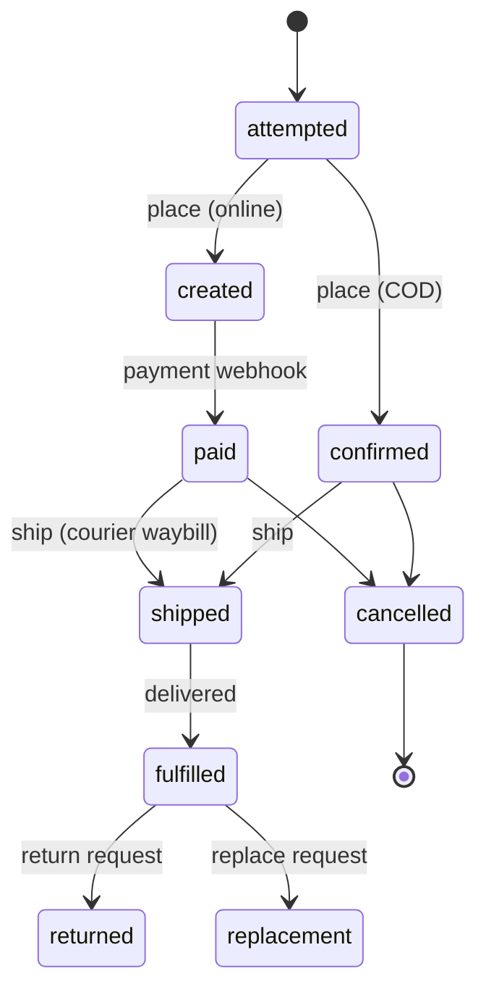
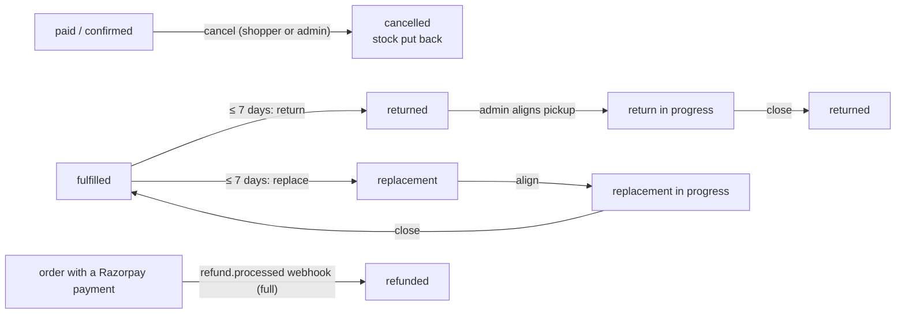
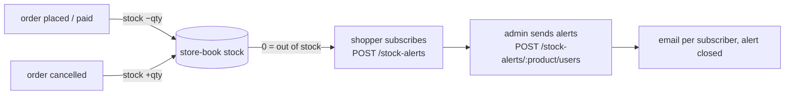
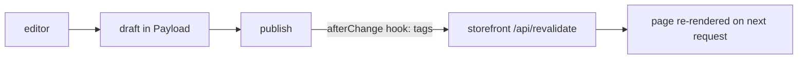
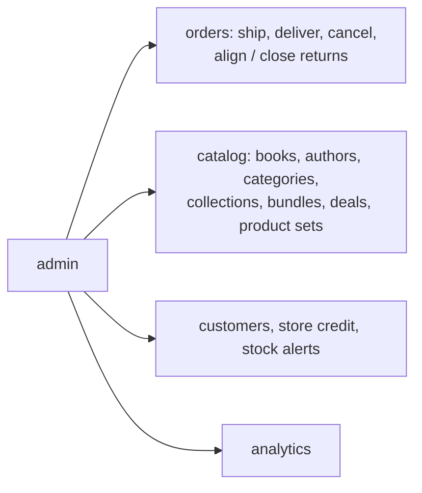
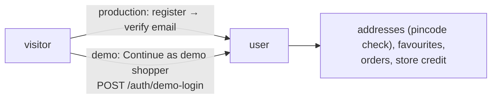

# Business flows

This doc covers the flows a real online bookstore needs, as Pageaters runs them. Each flow notes what happens
in the sandboxed demo and what a real store would also need. The full state machine and the code paths are in
[order-lifecycle.md](./order-lifecycle.md), and the guards are in [demo-mode.md](./demo-mode.md).

## 1. Browse → cart → checkout → payment → confirmation

The API prices the cart on the server. It never trusts totals sent by the client. Each user can have only one
pending order (`attempted` or `created`), and a unique index enforces this. Status changes are conditional
updates, so a second checkout or a repeated webhook cannot place the same order twice.

- **In the demo:** Razorpay runs in test mode with `rzp_test_…` keys, cash on delivery is available, and every
  email goes to the in-app outbox.
- **A real store would also need:** GST invoices and tax lines, a payment reconciliation report, and fraud or
  risk checks such as COD limits and address scoring.

## 2. Order lifecycle and fulfilment

The admin ships an order through the shipping adapter, which books a Delhivery waybill, and then marks it
delivered (`fulfilled`). Each step adds an `orderHistory` entry and sends the buyer an email. The state names
come from `OrderStatus` in `packages/shared/src/enums.ts`.

- **In the demo:** shipping uses the mock adapter and the warehouse address is fake. A weekly cleanup creates
  sample orders at each stage.
- **A real store would also need:** a warehouse or 3PL integration, pick-pack-ship tooling, courier tracking
  webhooks and delivery SLAs.

## 3. Cancellation, return and refund

Shoppers and admins can cancel an order only before it ships. Once an order is `shipped`, a cancel is refused
with `ORDER_CANCEL_INVALID`. Returns and replacements are allowed within 7 days of delivery. A refund is issued
in Razorpay, and its webhook marks the order `refunded`. A partial refund only adds a history entry. Store credit
works like a coupon: once applied, it is spent, and no cancel or refund gives it back.

- **In the demo:** there is no real money and no real pickup. The admin types in the return shipment id by hand.
- **A real store would also need:** reverse logistics with the courier, a quality check for returned stock,
  automated refunds for cancelled prepaid orders, and credit notes for GST.

## 4. Inventory and stock alerts

The API takes stock when an order is placed, which means confirmed for COD or paid for online orders. It puts
stock back when an order is cancelled. Bundles move the stock of each book inside them.

- **In the demo:** the catalog is seeded once with 1 to 1,000 copies of each book, and about 5% of books are out of
  stock. The weekly cleanup puts back the stock that visitors' orders took.
- **A real store would also need:** stock reservation during payment, supplier purchase orders, multi-warehouse
  stock and low-stock reports.

## 5. Content publishing

Pages, templates, overrides and globals have drafts and versions. Saving a draft changes nothing on the public
site. Publishing, unpublishing or deleting content expires the matching cache tags on the storefront. CMS blocks
refer to commerce records by ID, so prices and stock always come from the API. See [cms.md](./cms.md).

- **In the demo:** the public CMS login can only read, and only the owner publishes.
- **A real store would also need:** editorial roles and approval, scheduled publishing, and content localisation.

## 6. Admin operations

The admin talks to the API through `@pageaters/api-client`. Every route checks the `ADMIN` role on the server.

- **In the demo:** the demo admin can run order actions, but the catalog and customers are read-only. Saves are
  refused with a demo message. Only the owner's super-admin account can edit the catalog or upload files.
- **A real store would also need:** an audit log, fine-grained staff roles, bulk imports and exports, and
  accounting exports.

## 7. Customer account and auth

Sessions use cookies. Production uses email and password with email verification, password reset and phone
OTP. In demo mode these routes are turned off (`offInDemo`).

- **In the demo:** visitors use one-click shopper login, with no signup, OTP or password. The weekly cleanup
  deletes visitor data.
- **A real store would also need:** social or OTP login, account deletion and data export under privacy law,
  and bot protection on signup.
