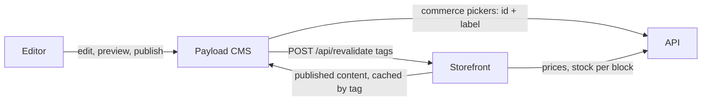

# CMS

Payload CMS 3 (`apps/cms`) owns the site's **content and layout**: pages, templates, header, footer, announcement
bar, theme and SEO. Commerce data (books, prices, stock, orders) stays in the API. The CMS only stores commerce
**IDs**, never a price or stock level, so nothing it holds can drift from the API. Why: editors change the look of the
store without touching money logic, and the API stays the single source of truth for commerce.

## Collections

| Collection | What it is                                                                                                                  | Drafts |
| ---------- | --------------------------------------------------------------------------------------------------------------------------- | ------ |
| Pages      | Free-form block pages by unique `slug`. `home` is `/`; any other slug is served at `/<slug>`.                               | Yes    |
| Templates  | One per page type (`product`, `collection`, `category`, `bundle`, `book-box`): the type's core blocks plus free blocks.     | Yes    |
| Overrides  | Optional free blocks for one item, keyed by `type` + the item's API id (unique together). No override → the template alone. | Yes    |
| Media      | Uploads (Vercel Blob under `cms/`, local disk without a token).                                                             | No     |
| Users      | CMS accounts with a role (below).                                                                                           | No     |

Code: `apps/cms/src/collections/`. Commerce ids are picked with a search-as-you-type field
(`components/CommercePicker.tsx`) backed by `GET /api/commerce/:kind?q=` (`endpoints/commerce.ts`, signed-in CMS users
only), which reads the API server-side and returns up to 20 `{ id, label }`.

Code-owned storefront routes are not CMS pages: cart, checkout, orders, `/authors/[id]`, `/book-boxes` and the
static `/about` page.

## Globals

All publicly readable, admin-only to update (`apps/cms/src/globals/`):

- **Header** — logo text and up to 6 navigation groups of links (navigation lives here, no separate global).
- **Footer** — contact text, up to 4 link columns, legal line, image credit ("Cover images via Open Library").
- **Announcement Bar** — on/off, message (≤140 characters), optional link.
- **Theme** — the 13 colour tokens of `packages/config/tailwind/theme.css` (hex) and `radius` (rem); the storefront
  writes them as CSS variables.
- **SEO defaults** — site name, title template with `%s`, description (≤160), share image.

Every link (`fields/link.ts`) must be a site path (`/…`) or an `https://` URL; `isSafeHref` in
`@pageaters/cms-types` is shared with the storefront, which checks again.

## Roles

`apps/cms/src/access.ts`, enforced server-side:

- `admin` (the owner) writes everything and manages accounts.
- `demo-readonly` (the public demo login `editor@demo.pageaters.com`, and the default for any new account) reads
  only: no content, media, global, password or role changes, no unlocking accounts.
- Visitors (the storefront) read published content, media and globals only.

`pnpm --filter cms seed:users` creates both accounts, so the first-user form is never open on a deployment.

## Drafts, live preview and revalidation

- Pages, Templates and Overrides have drafts and up to 25 versions. A draft save skips validation; **publishing**
  validates, so a template can't be published without its core blocks.
- **Live preview** (when `PREVIEW_SECRET` is set): the editor shows the storefront at
  `${STOREFRONT_URL}/api/draft?secret=…&path=…` — `/` or `/<slug>` for pages, `/preview/templates/<type>`,
  `/preview/overrides/<type>/<itemId>` — at mobile, tablet and desktop widths. The storefront renders the unsaved
  draft from live preview's postMessage data.
- **Revalidation** (when `REVALIDATE_SECRET` is set, `hooks/revalidate.ts`): after a publish, unpublish, change to a
  published document, delete or global save, the CMS posts to `${STOREFRONT_URL}/api/revalidate` with tags such as
  `cms:pages`, `cms:page:<slug>`, `cms:template:<type>`, `cms:override:<type>:<itemId>`, `cms:global:<slug>`. 3 s
  timeout; it never fails the save. Storefront CMS reads also expire after 5 minutes as a safety net.

## Blocks

Each Payload block (`apps/cms/src/blocks/`) has a storefront component in `apps/storefront/src/blocks/registry.ts` and
a type in `packages/cms-types`. The storefront renders each block in its own `<Suspense>`; an unknown or failing block
renders nothing and logs a warning, so a CMS mistake never breaks a page. Adding a block = Payload config +
storefront component + registry entry + a note here.

### Free blocks (pages, templates, overrides)

- **Banner** (`banner`) — one block for the five legacy banners: `layout` hero | full-bleed | square | landscape |
  promo. Required heading, optional text (≤240), optional image (plain backdrop without one) and optional link.
  Consecutive hero banners play as one slideshow.
- **Product Set row** (`productSetRow`) — optional heading, a product set picked from the API, `limit` 4–24 books.
- **Featured Books** (`featuredBooks`) — a row from one book flag: `bestSeller`, `editorsPick`, `newRelease` or
  `preOrder`; `limit` 4–24.
- **Carousel** (`carousel`) — collections, categories, bundles or deals; `display` row (carousel) or grid (a listing
  page under the page heading); `limit` 4–24.
- **Rich text** (`richText`) — Lexical content. Links must be safe (a site path or `https://`), auto-links are off and
  internal links point at CMS pages only; the storefront renders no raw HTML.
- **FAQ** (`faq`) — optional heading and a list (at least one) of questions with plain-text answers. Rendered as an
  accordion of native `
`/`
` rows: no client JS, keyboard and screen-reader friendly, line breaks in
  answers kept.

### Core blocks (templates only)

The commerce part of a page type, rendered from the page's item. A template must hold each of its type's core blocks
exactly once and none of another type's (`validateCoreBlocks`): they can be moved, not removed.

| Block                                  | Template types            | Options                 |
| -------------------------------------- | ------------------------- | ----------------------- |
| Product info + buy box (`productInfo`) | product, bundle, book-box | —                       |
| Listing header (`listingHeader`)       | collection, category      | `showDescription`       |
| Listing grid (`listingGrid`)           | collection, category      | `pageSize` 12, 24 or 48 |

## Seed content

`pnpm --filter cms seed:content` (`src/seed/content.ts`) creates, published and only when missing: the homepage
(promo banner, best sellers, two product set rows, collections and bundles carousels, new releases), one template
per page type, the header, footer, announcement bar, theme and SEO globals, and a page for every header/footer link.
