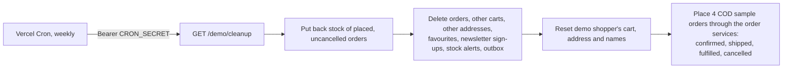

# Demo mode

Pageaters is a closed bookstore rebuilt as a **sandboxed portfolio demo**, not a live store. Every deployment runs
with `DEMO_MODE=true`. Visitors can browse, order and run the admin's order lifecycle, but nothing reaches a real
inbox, phone, card or courier, and nobody can change the catalog.

**Why server-side:** a hidden button is not a guard. Every rule below is enforced in the API or the CMS, so a visitor
calling the API directly gets the same refusal as the UI.

## What changes with `DEMO_MODE=true`

| Area            | Behaviour                                                                                                                                                                                                                                                      | Code                                                                                           |
| --------------- | -------------------------------------------------------------------------------------------------------------------------------------------------------------------------------------------------------------------------------------------------------------- | ---------------------------------------------------------------------------------------------- |
| Boot checks     | The API refuses to start unless `EMAIL_ADAPTER` and `SMS_ADAPTER` are `mock`, no SendGrid/Twilio key is set, and `CRON_SECRET` is set. A `rzp_live_` Razorpay key is refused in every mode.                                                                    | `apps/api/src/env.js` (`demoModeProblems`, `RAZORPAY_KEY_ID`)                                  |
| Shopper login   | No signup or OTP. `POST /auth/demo-login` signs into the seeded demo shopper. Register, the `/auth/contact/*` OTP routes, verify-email and forgot/reset-password answer `OFF_IN_DEMO_MODE`.                                                                    | `apps/api/src/routes/auth.routes.js`, `middlewares/demoMode.middleware.js`                     |
| Admin login     | `POST /auth/demo-login/admin` signs into the demo admin ("Sign in as demo admin" on the admin login page). Both demo logins share a `demoLogin` rate limit and are 404 outside demo mode.                                                                      | `apps/admin/src/app/auth/login/`                                                               |
| Read-only admin | The demo admin's catalog writes (27 routes), `POST /file/upload` and `POST /store-credit` are refused with `DEMO_ADMIN_READ_ONLY`. Order actions (ship, deliver, cancel) and all reads stay open. The admin UI also disables save and upload on catalog forms. | `demoAdminReadOnly` in `demoMode.middleware.js`; `DemoAdminService` in the admin               |
| Super-admin     | The owner's own account (from `SUPER_ADMIN_EMAIL`/`SUPER_ADMIN_PASSWORD` at seed time) is never refused, so the owner can fix records and upload images on the live demo. It is never listed as a demo login.                                                  | `demoAdminReadOnly` keys on the demo admin's e-mail only                                       |
| Outbox          | The mock e-mail and SMS adapters save each message to the `outbox` collection. `GET /outbox` returns the newest 50 sent to the caller's e-mail or phone; an admin other than the demo admin sees all. Admin page: `admin/outbox`.                              | `apps/api/src/services/outbox.service.js`, `apps/admin/src/app/admin/outbox/`                  |
| Payments        | Razorpay test mode only (`rzp_test_…`). Checkout also offers cash on delivery.                                                                                                                                                                                 | `apps/api/src/env.js`, [order-lifecycle.md](./order-lifecycle.md)                              |
| CMS             | The login form is prefilled with the public read-only login `editor@demo.pageaters.com`. Its `demo-readonly` role can read but not write content, media, globals, accounts or its own password.                                                                | `apps/cms/src/demo.ts`, `access.ts`, `collections/Users.ts`                                    |
| Banner          | The storefront and admin show "Portfolio demo — not a real store. No real orders, payments or deliveries." on every page.                                                                                                                                      | `apps/storefront/src/components/site/demo-banner.tsx`, `apps/admin/src/app/app.component.html` |

The demo admin cannot change its password in practice: `PUT /auth/password` needs the current password, and the
seeded one is random and never shown. Forgot/reset-password is off in demo mode, so the account can't be taken over.

Outside demo mode the outbox is not written (reset and verify tokens in mails must never be stored) and the demo-only
routes answer 404.

## Demo accounts

Seeded by `pnpm seed` (`seed/src/accounts.ts`) and `pnpm --filter cms seed:users`:

| Account      | Login                                      | Can do                                                    |
| ------------ | ------------------------------------------ | --------------------------------------------------------- |
| Demo shopper | One click on the storefront                | Cart, addresses, favourites, checkout, orders, search     |
| Demo admin   | One click on the admin login page          | Read everything; confirm, ship, deliver and cancel orders |
| CMS editor   | `editor@demo.pageaters.com` (prefilled)    | Read pages, templates, overrides and globals              |
| Super-admin  | Owner only, password from the local `.env` | Everything, including catalog edits and uploads           |

## Weekly cleanup

`GET /api/v1/demo/cleanup` (`apps/api/src/routes/demo.routes.js`, `services/demo-cleanup.service.js`) is meant for a
weekly Vercel Cron call (set up in Phase 10, see [deployment.md](./deployment.md)). It is 404 outside demo mode and
needs `Authorization: Bearer <CRON_SECRET>`, compared in constant time.

It touches only visitor data, never the catalog. The sample orders go through the same services as real checkouts, so
their e-mails land in the fresh outbox.

## Known limits

- Rate limits count per serverless instance (no shared store).
- Anyone can lock the public CMS login for 10 minutes with 5 wrong passwords.
