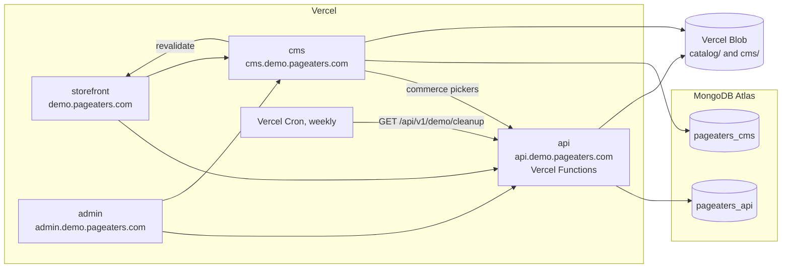

# Deployment

> **Status:** planned. CI/CD and the Vercel projects are **set up in Phase 10** of `PLAN.md`; nothing below is live
> yet. This page describes the target, and the code that already exists for it.

The deployment is a sandboxed portfolio demo, not a live store. Every project runs with `DEMO_MODE=true`
([demo-mode.md](./demo-mode.md)). The root domain `pageaters.com` is never used.

## Topology

Why everything on Vercel: one platform for four apps, preview deploys per PR and Cron without a server. The API is
written to be serverless-safe for that reason: no in-process state, timers or local files; scheduled work is Cron
hitting a protected endpoint, files go to Blob. Atlas (free tier) holds two databases so content and commerce never
share one.

## Vercel projects (Phase 10)

Four projects from one repo, each with its app as root directory, `turbo-ignore` to skip unaffected builds, and
preview deploys per PR. The admin build output is `dist/pageaters-admin/browser`.

## Environment variables by project

Names only; each is documented in the app's `.env.example`. Values live in Vercel, never in the repo.

| Project    | Variables                                                                                                                                                                                                                                                                                                                                                                       |
| ---------- | ------------------------------------------------------------------------------------------------------------------------------------------------------------------------------------------------------------------------------------------------------------------------------------------------------------------------------------------------------------------------------- |
| api        | `APP_ENV`, `DEMO_MODE=true`, `CRON_SECRET`, `STOREFRONT_URL`, `ALLOWED_ORIGINS`, `LOG_LEVEL`, `ENCRYPTION_KEY`, `MONGODB_URI`, `EMAIL_ADAPTER=mock`, `SMS_ADAPTER=mock`, `SHIPPING_ADAPTER=mock`, `PAYMENTS_ADAPTER=razorpay`, `RAZORPAY_KEY_ID` (`rzp_test_…`), `RAZORPAY_KEY_SECRET`, `RAZORPAY_WEBHOOK_SECRET`, `STORAGE_ADAPTER=blob`, `BLOB_READ_WRITE_TOKEN`, `MAIL_FROM` |
| cms        | `MONGODB_URI` (the CMS database), `PAYLOAD_SECRET`, `API_URL`, `STOREFRONT_URL`, `ADMIN_URL`, `PREVIEW_SECRET`, `REVALIDATE_SECRET`, `DEMO_MODE=true`, `BLOB_READ_WRITE_TOKEN`                                                                                                                                                                                                  |
| storefront | `API_URL`, `NEXT_PUBLIC_API_URL`, `CMS_URL`, `SITE_URL`, `PREVIEW_SECRET`, `REVALIDATE_SECRET` (the last two shared with the CMS)                                                                                                                                                                                                                                               |
| admin      | None: the API and CMS URLs are build-time constants in `apps/admin/src/environments/environment.prod.ts`                                                                                                                                                                                                                                                                        |

The API refuses to boot with a `rzp_live_` key, with non-mock e-mail/SMS in demo mode, or without
`RAZORPAY_WEBHOOK_SECRET` in staging/production (`apps/api/src/env.js`). `SUPER_ADMIN_*` are seed-time only and read
from the owner's local `.env`.

## Cron cleanup (Phase 10)

A weekly Vercel Cron entry calls `GET /api/v1/demo/cleanup`. Vercel sends `Authorization: Bearer <CRON_SECRET>`,
which the endpoint checks; it wipes visitor data and places fresh sample orders ([demo-mode.md](./demo-mode.md)).

## Remaining Phase 10 plan

- GitHub Actions: lint, typecheck, test and build through Turbo (affected only), plus gitleaks; a CMS types drift
  check.
- Serverless rate limits: let the storefront's server-side requests through with a shared-secret header (they all
  arrive from one IP) and drop slow-down on Vercel.
- DNS for the four `*.demo.pageaters.com` hosts; check the `one_pending_order_per_user` index exists (MongoDB 6.0+).
- Checkpoint: all four apps live and the E2E passing against the demo.
