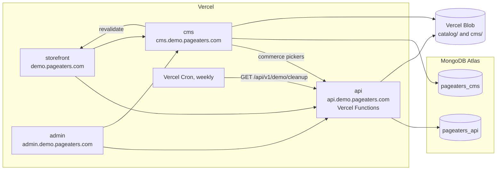

# Deployment

> **Status:** live since 2026-11-02. All four apps run on Vercel, and the checkout E2E test passes against the demo.

The deployment is a sandboxed portfolio demo, not a live store. Every project runs with `DEMO_MODE=true`
([demo-mode.md](./demo-mode.md)). The root domain `pageaters.com` is never used.

## Topology

Why everything on Vercel: one platform for four apps, preview deploys per PR and Cron without a server. The API is
written to be serverless-safe for that reason: no in-process state, timers or local files; scheduled work is Cron
hitting a protected endpoint, files go to Blob. Atlas (free tier) holds two databases so content and commerce never
share one.

## CI (GitHub Actions)

`.github/workflows/ci.yml` runs on every pull request and every push to `main`:

- **checks**: pnpm (version from `packageManager`, store cached) on Node 22, then
  `turbo run lint typecheck test build --affected` against the PR base (or the previous `main` head on a push), on a
  full-depth checkout. The MongoDB binary the API tests download is cached at `~/.cache/mongodb-binaries`.
- **gitleaks**: scans the full history with `.gitleaks.toml` (gitleaks CLI, pinned version).

The builds need no live services: the storefront's `sitemap.ts` and `/book-boxes` fall back to empty lists when the
API and CMS are unreachable (Vercel builds fetch the real ones, and pages refresh at runtime), and the CMS build only
validates its env, so CI sets a never-contacted local `MONGODB_URI` and a throwaway `PAYLOAD_SECRET` generated in the
job. Playwright E2E is not run in CI (it needs all four apps and a seeded database); run it locally or against the
demo.

Turbo runs in strict env mode, so a build only sees the variables declared for it: `apps/storefront/turbo.json` and
`apps/cms/turbo.json` list theirs (`env` for values that change the output, `passThroughEnv` for secrets). A new
build-time variable must be added there too, or the Vercel build won't see it.

## Vercel projects (owner action)

Four projects from one repo. Each app's `vercel.json` sets the commands; the dashboard needs only the root directory,
the framework preset and the domain. `ignoreCommand` is `npx turbo-ignore`, so a project skips a build when neither
its app nor a workspace package it depends on changed. Preview deploys per PR are Vercel's default once the GitHub repo
is connected.

| Project    | Root directory    | Framework preset | Install                          | Build (from the repo root)                | Output                         | Domain                     |
| ---------- | ----------------- | ---------------- | -------------------------------- | ----------------------------------------- | ------------------------------ | -------------------------- |
| storefront | `apps/storefront` | Next.js          | `pnpm install --frozen-lockfile` | `turbo run build --filter=storefront`     | Next.js default                | `demo.pageaters.com`       |
| admin      | `apps/admin`      | Angular          | `pnpm install --frozen-lockfile` | `turbo run build --filter=admin`          | `dist/pageaters-admin/browser` | `admin.demo.pageaters.com` |
| cms        | `apps/cms`        | Next.js          | `pnpm install --frozen-lockfile` | `turbo run build --filter=cms`            | Next.js default                | `cms.demo.pageaters.com`   |
| api        | `apps/api`        | Other            | `pnpm install --frozen-lockfile` | `turbo run build --filter=api^...` (deps) | `public` (static `terms.html`) | `api.demo.pageaters.com`   |

- **api**: one Vercel Function, `apps/api/api/index.js`, which exports the Express app from `src/app.js`; every path
  is rewritten to it, and `src/**` (e-mail templates, locales, views) is bundled with it. The app validates its env on
  import and connects to MongoDB on the first database-backed request.
- **admin**: a single-page app; unknown paths are rewritten to `index.html`. Its API and CMS URLs are build-time
  constants (`apps/admin/src/environments/environment.prod.ts`).
- In every project's settings: enable "Include files outside the root directory" (the workspace packages), and set
  `ENABLE_EXPERIMENTAL_COREPACK=1` so Vercel uses the pnpm version pinned in `packageManager`, and set Node.js Version to 22.x (the repo requires 22; Vercel defaults newer).

Owner steps: create the four projects from the GitHub repo with the root directories above, add the variables below
(Production and Preview), add the domains and their DNS records (`CNAME` to Vercel, `*.demo.pageaters.com` only, never
the root `pageaters.com`).

## Environment variables by project (owner action)

Names only; each is documented in the app's `.env.example`. Values are entered by the owner in Vercel, never in the
repo. Where a value is fixed for the demo it is shown; everything else is the owner's. Every project also gets
`ENABLE_EXPERIMENTAL_COREPACK=1` (above). `VERCEL` is set by Vercel itself.

**api**

- [ ] `DEMO_MODE=true`
- [ ] `APP_ENV` (`staging`; never `test` on Vercel)
- [ ] `CRON_SECRET` (at least 16 characters; Vercel Cron sends it)
- [ ] `ENCRYPTION_KEY` (exactly 32 characters: `openssl rand -hex 16`)
- [ ] `INTERNAL_API_SECRET` (at least 32 characters; same value as the storefront's)
- [ ] `MONGODB_URI` (database `pageaters_api`)
- [ ] `STOREFRONT_URL`, `ALLOWED_ORIGINS` (the storefront and admin origins), `LOG_LEVEL` (optional)
- [ ] `PAYMENTS_ADAPTER=razorpay` with `RAZORPAY_KEY_ID` (test key, `rzp_test_…`), `RAZORPAY_KEY_SECRET`,
      `RAZORPAY_WEBHOOK_SECRET`
- [ ] `STORAGE_ADAPTER=blob` with `BLOB_READ_WRITE_TOKEN`
- [ ] `EMAIL_ADAPTER=mock`, `SMS_ADAPTER=mock`, `SHIPPING_ADAPTER=mock`; `MAIL_FROM` (optional)
- Never set on the demo: `SENDGRID_API_KEY`, `TWILIO_*`, `DELHIVERY_*` (demo mode refuses the first two),
  `SUPER_ADMIN_*` (seed only)

**cms**

- [ ] `DEMO_MODE=true`
- [ ] `MONGODB_URI` (database `pageaters_cms`, never `pageaters_api`)
- [ ] `PAYLOAD_SECRET`
- [ ] `BLOB_READ_WRITE_TOKEN` (required on Vercel)
- [ ] `API_URL`, `STOREFRONT_URL`, `ADMIN_URL`
- [ ] `PREVIEW_SECRET`, `REVALIDATE_SECRET` (same values as the storefront's)

**storefront**

- [ ] `API_URL`, `NEXT_PUBLIC_API_URL`, `CMS_URL`, `SITE_URL`
- [ ] `PREVIEW_SECRET`, `REVALIDATE_SECRET` (shared with the CMS)
- [ ] `INTERNAL_API_SECRET` (same value as the API's; server-only, never `NEXT_PUBLIC_`)

**admin**: none; the API and CMS URLs are build-time constants in `apps/admin/src/environments/environment.prod.ts`.

The API refuses to boot with a `rzp_live_` key, with non-mock e-mail/SMS in demo mode, or without
`RAZORPAY_WEBHOOK_SECRET` in staging/production (`apps/api/src/env.js`). `SUPER_ADMIN_*` are seed-time only and read
from the owner's local `.env`.

## Cron cleanup

`apps/api/vercel.json` schedules `GET /api/v1/demo/cleanup` weekly (Mondays 03:00 UTC, `0 3 * * 1`). Vercel Cron runs
on production deployments only and sends `Authorization: Bearer <CRON_SECRET>`, which the endpoint checks; it wipes
visitor data and places fresh sample orders ([demo-mode.md](./demo-mode.md)).

## Remaining Phase 10 plan

- A CMS types drift check in CI.
- Serverless rate limits: let the storefront's server-side requests through with a shared-secret header (they all
  arrive from one IP) and drop slow-down on Vercel.
- DNS for the four `*.demo.pageaters.com` hosts; check the `one_pending_order_per_user` index exists (MongoDB 6.0+).
- Checkpoint: all four apps live and the E2E passing against the demo.
