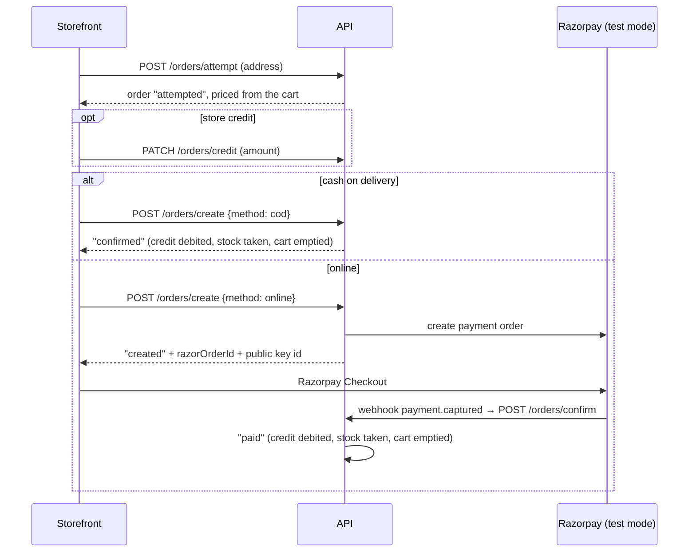
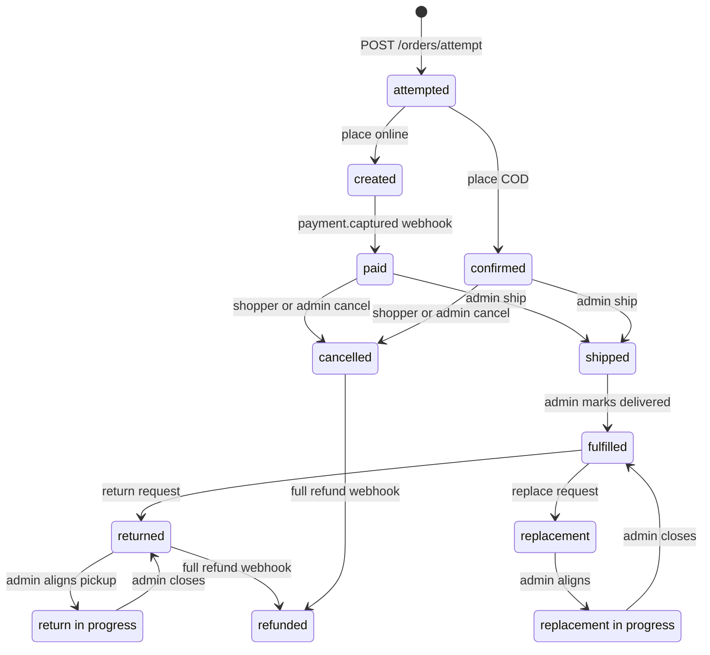

# Order lifecycle (with checkout)

How a cart becomes an order, how the order moves through its states, and the money rules. All of it lives in the
API (`apps/api/src/services/order-*.service.js`); the storefront and admin only call it through
`packages/api-client`. State names come from `OrderStatus` in `packages/shared/src/enums.ts`.

## Checkout

Storefront pages: `/cart` → `/checkout/address` → `/checkout` → `/order-confirm/[id]`; orders at `/account/orders`
(`apps/storefront/src/app/(shop)/`, `components/cart/checkout-view.tsx`).

**Pricing** (`order-pricing.service.js`, `cart-pricing.service.js`): always recomputed on the server from today's
catalog prices; the client never sends a price.

- Each unit price is floored after its discount, so the order lines add up to the subtotal.
- Shipping: free above ₹599, otherwise ₹50 (₹125 with a mystery box). Taxes are 0.
- Gift wrap costs come from the server's list (`GIFT_PACKAGES` in `packages/shared`); a sent cost is ignored.
- **Total = subtotal + shipping + gift charges − store credit.**

**One pending order per user.** Starting checkout again takes over the existing `attempted`/`created` order (new order
id, its Razorpay order and applied credit dropped). A unique partial index (`one_pending_order_per_user`) keeps it to
one even when two first attempts race. Why: every later step acts on exactly one order, so a double click or a second
tab can't create two.

**Store credit is a spent coupon.** It can be applied only to an `attempted` order and never above the balance or the
order total. The balance is debited when the order is confirmed (COD) or paid (webhook). It is never given back: not
on cancel, not on refund. Why: it keeps the money rules simple and matches the original store. Admins issue credit
with `POST /store-credit` (refused for the demo admin).

**Payments.** Razorpay runs in test mode only (`rzp_test_…`; see [demo-mode.md](./demo-mode.md)). The webhooks
(`POST /orders/confirm`, `POST /orders/refund/processed`) are public but act only on the signed raw body; a bad
signature or unknown order does nothing. A total under ₹1 can't be paid online; a total of 0 (all store credit) is
placed as COD. Locally the test webhook can't reach `localhost`, so an online order stays `created`; use cash on
delivery (the E2E spec does).

## Order states

Every transition is a conditional update on the state the order was read in (`order-transition.service.js`), so of
two concurrent actions (say a cancel and a ship) only one wins; the other gets 409 `ORDER_CHANGED_CONFLICT`.

A full refund webhook moves an order with a Razorpay payment to `refunded` from any stage (legacy, kept); the
diagram shows the usual two. The return/replacement branch is kept from the original store; the demo focuses on the main path
(`confirmed`/`paid` → `shipped` → `fulfilled`, or `cancelled`). The full map is also the header comment of
`order-lifecycle.service.js`.

## Admin actions

From the admin order page (`apps/admin/src/app/admin/orders/view/`), allowed for the demo admin too:

- **Ship** — `POST /orders/ship` with a tracking id, from `paid` or `confirmed`; e-mails the buyer. Shipping uses
  the mock adapter in the demo.
- **Deliver** — `PATCH /orders/ship/:id/complete`, `shipped` → `fulfilled`; e-mails the buyer.
- **Cancel** — `POST /orders/admin-cancel/:id` with a reason.

## Cancel rules

- Only `paid` or `confirmed` orders can be cancelled, by the shopper (`POST /orders/cancel/:uniqueId`) or an admin.
  **Never after shipping**: a shipped or later order answers `ORDER_CANCEL_INVALID`, and the admin hides Cancel
  (`canCancelOrder`). Why: once the courier has the parcel, the demo has no recall flow.
- A cancel puts the stock back and e-mails the buyer (a failed e-mail never fails the cancel).
- A cancel starts no refund and keeps store credit spent.
- The storefront has no cancel button today; the API route and api-client method exist.

## Refunds

Refunds are recorded from Razorpay's `refund.processed` webhook (`order-refunds.service.js`); there is no
"refund" button that calls Razorpay. Each refund id counts once. A full refund (the payment's refunded amount reaches
its amount) moves the order to `refunded`; a partial one adds a history entry. **A refund returns only the money
paid**: store credit applied to the order stays spent.
